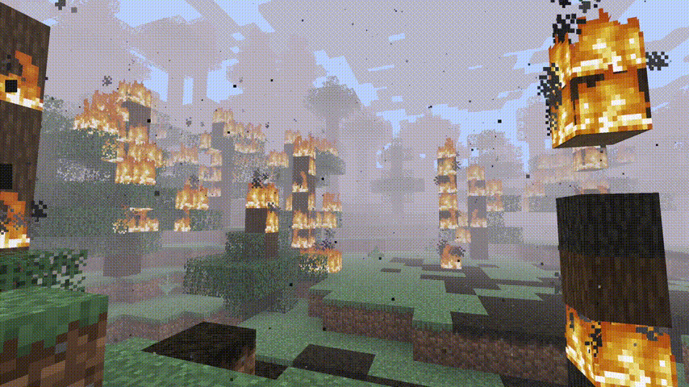
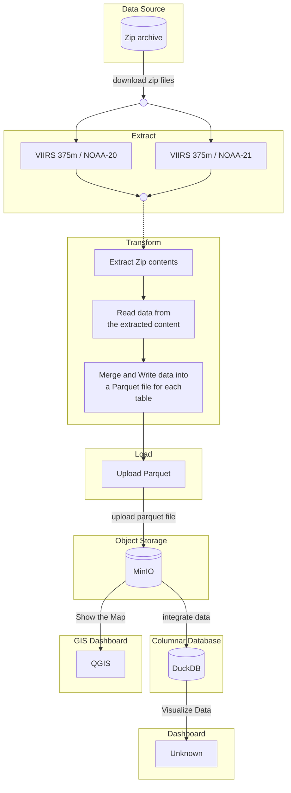
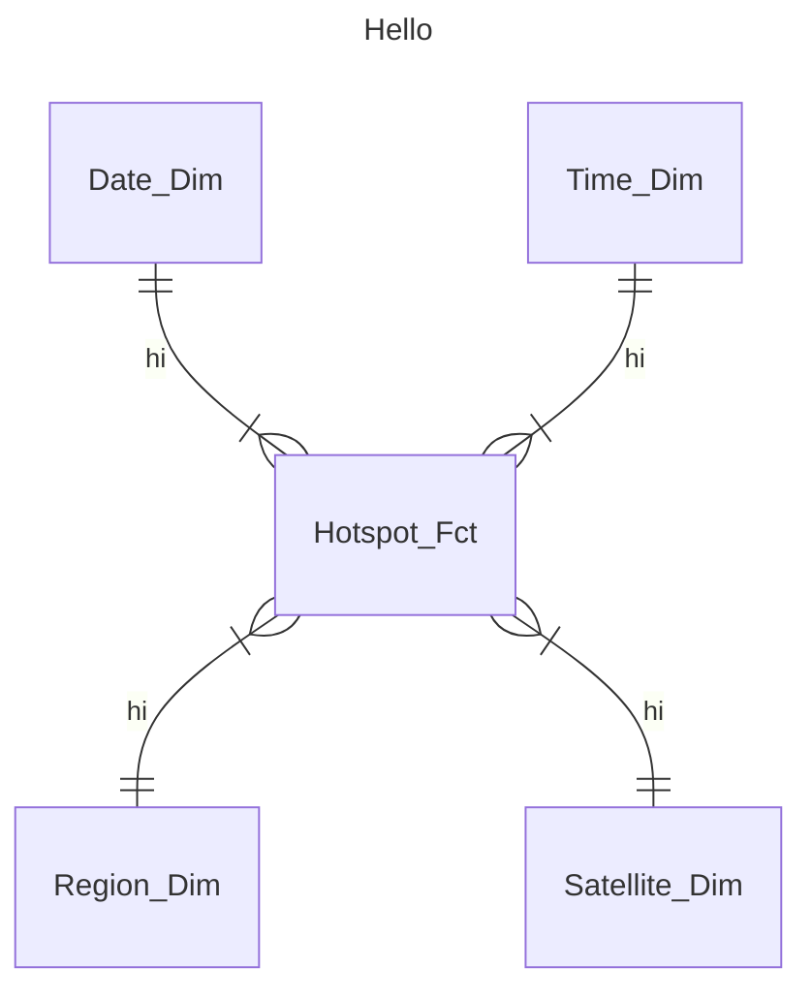

# Wildfire ETL Platform
## An ETL Platform to process and store wildfire data.

Source: [NASA FIRMS](https://firms.modaps.eosdis.nasa.gov/active_fire/)\
Raw data format:
  + A zipfile containing:
    - .shp (Shapefile): Geomatry file that contains the coordinates of the Fire Spots
    - .dbf (dBase database file): Shapefile attribute format
    - .cpg (Character encoding file): a file format containing a set of characters of text in shapefile in different languages depending on the location.
    - .shx (Shape index format): a file that stores index and offset information from the main Shapefile (.shp).
    - .prj (Projection description): a project file from dBase.

## Architecture

## Data Model
I used Star Schema Model for the Data Warehouse.

## Tech Stack

<!--  -->
